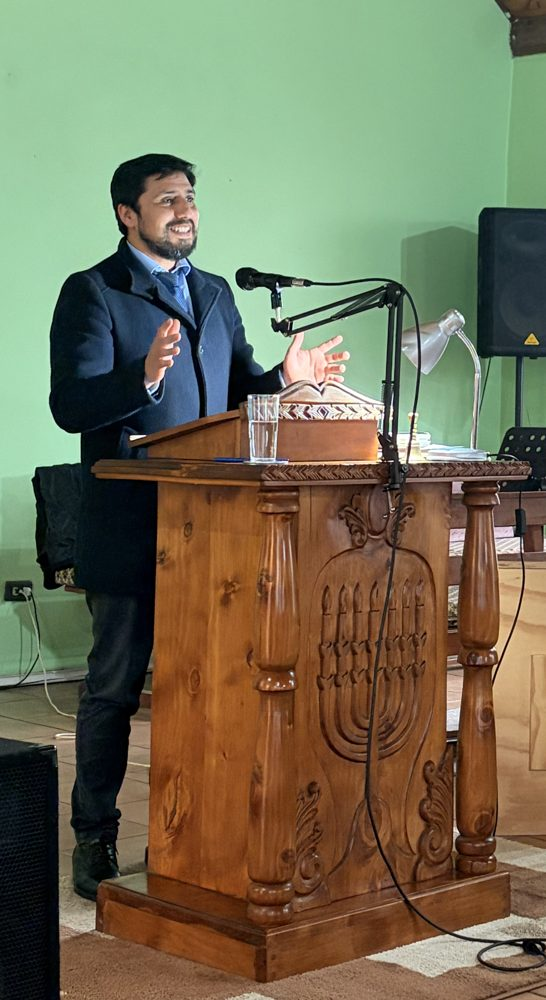
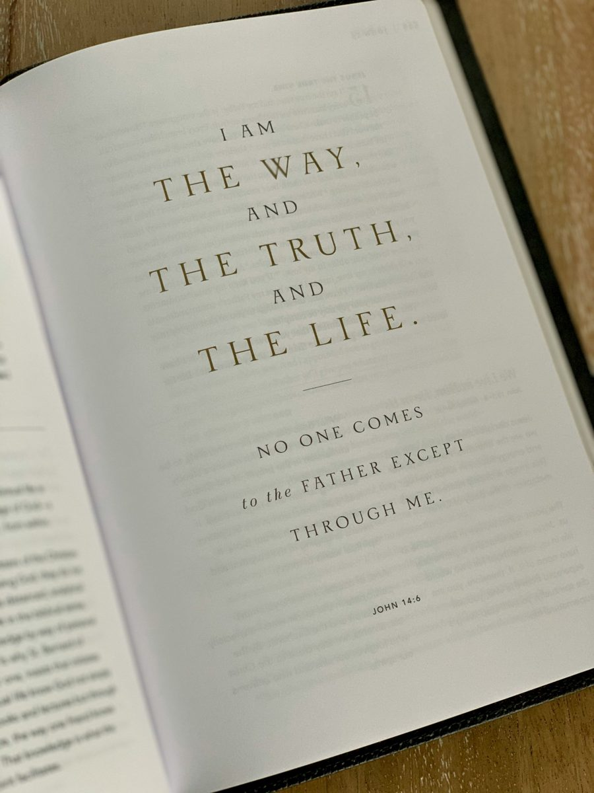

<!-- PORTADA ------------------------------------------------------------>

:::::: {.hero .g #inicio}
::::: {.wrap .hero-grid}
:::: {.hero-text}
[Estudios bíblicos y teológicos]{.label}

# Danilo Gómez Correa

[La Escritura explicada *por el conocimiento del Dios de la Biblia.*]{.sub}

[Ensayos, estudios, videos y podcast.]{.lead}


::::
:::: {.hero-media}
```{=html}

<div class="hero-badge">
<div class="badge-body" id="badge-body" aria-hidden="true"><div class="badge-inner">
<button type="button" class="badge-cerrar" aria-label="Cerrar">&times;</button>
<span class="sobre-label">Sobre mí</span>
<p>Soy Danilo Gómez Correa y estudio en el Israel Institute of Biblical Studies. Mi punto de partida es conocer al Dios de la Biblia, al Dios de Israel, cuyo nombre es sin igual, porque no hay Dios como Él: quién es Él y cuáles son sus atributos.</p>
<p>Procuro, principalmente, ser guiado por el Espíritu de Dios para estudiar su Palabra. Después viene el método: histórico, filológico, teológico y literario. Primera Línea es donde ordeno y comparto lo que aprendo.</p>
</div></div>
<button type="button" class="badge-head" aria-expanded="false" aria-controls="badge-body" title="Sobre mí"><span class="badge-txt"><b>Danilo Gómez Correa</b><span>Estudiante · Israel Institute of Biblical Studies</span></span></button>
</div>
<script>
(function(){
  var w=document.querySelector('.hero-badge'); if(!w) return;
  var h=w.querySelector('.badge-head'), body=w.querySelector('.badge-body');
  function set(on){ w.classList.toggle('open',on); h.setAttribute('aria-expanded',on); body.setAttribute('aria-hidden',!on); }
  h.addEventListener('click',function(e){ e.stopPropagation(); set(!w.classList.contains('open')); });
  w.querySelector('.badge-cerrar').addEventListener('click',function(e){ e.stopPropagation(); set(false); h.focus(); });
  w.addEventListener('click',function(e){ e.stopPropagation(); });
  document.addEventListener('click',function(){ set(false); });
  document.addEventListener('keydown',function(e){ if(e.key==='Escape') set(false); });
})();
</script>
<span class="gen heb" lang="he" aria-hidden="true">בְּרֵאשִׁית</span>
```
::::
:::::
::::::

<!-- VERSÍCULO -------------------------------------------------------->

:::: {.scroll-band .g}
::: {.wrap .verse}
<div>
[נֵר־לְרַגְלִי דְבָרֶךָ וְאוֹר לִנְתִיבָתִי]{.orig .heb lang="he"}

[Lámpara es a mis pies tu palabra, y lumbrera a mi camino.]{.tr}

[Salmo 119:105 · Reina-Valera 1909]{.ref}

[El salmista usa [נֵר]{.heb lang="he"} (*ner*), la lámpara de aceite de barro que iluminaba apenas el paso siguiente. Así ilumina la Palabra: paso a paso. No nos muestra todo el camino de una vez; por eso, lo que sigue es confiar en Dios, que alumbra cada paso y conoce el final del camino.]{.note}
</div>
<div class="lampbox" aria-hidden="true">
```{=html}
<svg viewBox="0 0 420 260">
        <defs><radialGradient id="g2" cx="50%" cy="50%" r="50%"><stop offset="0" stop-color="#F2913F" stop-opacity=".35"/><stop offset="1" stop-color="#F2913F" stop-opacity="0"/></radialGradient></defs>
        <circle cx="120" cy="120" r="120" fill="url(#g2)"/>
        <g transform="translate(110 150)">
          <path d="M10 40 C40 78 230 78 270 40 C250 14 190 2 140 2 C80 2 34 14 10 40Z" fill="#9A6236"/>
          <path d="M10 40 C40 58 230 58 270 40" stroke="#5E3818" stroke-width="3" fill="none"/>
          <ellipse cx="140" cy="18" rx="30" ry="9" fill="#4A2C15"/>
          <circle cx="140" cy="18" r="4" fill="#2A1808"/>
          <path d="M270 40 c22-2 32-20 20-30" stroke="#9A6236" stroke-width="8" fill="none" stroke-linecap="round"/>
          <path d="M16 32 C0 28 -8 16 0 8 C10 16 18 22 28 24Z" fill="#9A6236"/>
          <path class="fl" d="M2 10 C-18 -24 6 -56 2 -84 C30 -52 34 -20 12 10Z" fill="#F7B84F"/>
          <path d="M4 6 C-4 -12 4 -32 4 -46 C16 -28 16 -10 10 6Z" fill="#FFF0C2"/>
        </g>
      </svg>
```
</div>
:::
::::

<!-- MÉTODO ------------------------------------------------------------->

:::: {.band .g .flush #metodo}
::: {.wrap}
<div class="head">
<div>
## Método de estudio
</div>

Cada estudio busca dar a conocer al Dios de Israel: conocer al Autor y sus perfecciones eternas, ver la armonía perfecta de sus atributos y contemplar una Escritura coherente con su carácter.
</div>

```{=html}
<script>
document.addEventListener('DOMContentLoaded',function(){
document.querySelectorAll('.enfoque .flip, .method .mflip').forEach(function(c){
  function t(){var on=c.classList.toggle('is-flipped');c.setAttribute('aria-pressed',on?'true':'false');}
  c.addEventListener('click',t);
  c.addEventListener('keydown',function(e){if(e.key==='Enter'||e.key===' '){e.preventDefault();t();}});
});
});
</script>
<p class="enfoque-sub">Para eso, cada pasaje se estudia con cuatro métodos:</p>
<div class="method">
  <div class="m mflip" role="button" tabindex="0" aria-pressed="false" aria-label="Método histórico: ver definición"><div class="inner"><div class="face front"><h3>Histórico:<em>contexto</em></h3></div><div class="face back"><h3>Método histórico</h3><p>El análisis histórico estudia el contexto en que se escribió el texto: quién lo escribió, a quién, cuándo y en qué circunstancias sociales, políticas y religiosas. Así se entiende qué significó para sus primeros lectores.</p></div></div></div>
  <div class="m mflip" role="button" tabindex="0" aria-pressed="false" aria-label="Método filológico: ver definición"><div class="inner"><div class="face front"><h3>Filológico:<em>palabras</em></h3></div><div class="face back"><h3>Método filológico</h3><p>El análisis filológico estudia el texto en sus lenguas originales, hebreo, arameo y griego: el significado de cada palabra, su raíz, su forma gramatical y cómo se usa en el resto de la Escritura.</p></div></div></div>
  <div class="m mflip" role="button" tabindex="0" aria-pressed="false" aria-label="Método teológico: ver definición"><div class="inner"><div class="face front"><h3>Teológico:<em>revelación</em></h3></div><div class="face back"><h3>Método teológico</h3><p>El análisis teológico explora lo que el texto enseña sobre Dios, sus doctrinas, principios y mensaje, y lo lee en armonía con el conjunto de la Escritura, sin contradecir lo que ella enseña con claridad.</p></div></div></div>
  <div class="m mflip" role="button" tabindex="0" aria-pressed="false" aria-label="Método literario: ver definición"><div class="inner"><div class="face front"><h3>Literario:<em>forma</em></h3></div><div class="face back"><h3>Método literario</h3><p>El análisis literario estudia el texto como obra escrita: su género, estilo, estructura y recursos como el paralelismo, y el lugar que ocupa dentro del libro y del canon bíblico.</p></div></div></div>
</div>
<p class="principle"><span>Principio</span>La Escritura se explica con la Escritura: los pasajes claros gobiernan y dan luz a los menos claros, de Génesis a Apocalipsis.</p>
<p class="metodo-link"><a class="btn ghost" href="metodologia.html">Ver la metodología completa</a></p>
```
:::
::::

<!-- PREDICACIÓN ----------------------------------------------------->

:::: {.band .g #predicacion .flush}
::: {.wrap .preach .nophoto .onecol}
<div>
[Enseñanza]{.label}

## Del estudio al púlpito

[Lo que estudio termina en la exposición de la Palabra frente a la congregación. Como aprendiz de la Palabra, intento mostrar cómo un pasaje de la Escritura se subordina armónicamente a la voluntad del Dios de Israel y cómo se conecta con el resto de la Biblia, para que quien escucha pueda abrir su Biblia y comprobarlo.]{.body}

> Y éstos eran más nobles que los que estaban en Tesalónica, pues recibieron la palabra con toda solicitud, escudriñando cada día las Escrituras para ver si estas cosas eran así.
> [Hechos 17:11 · Reina-Valera 1960]{.cite}

[Mi propósito es, primero, transmitir el conocimiento de Dios, para que Él sea exaltado, admirado, honrado y, principalmente, temido por sus maravillas y sus proezas. Ir del estudio al púlpito es exhibir, honrar y engrandecer a Dios en toda su magnitud, y comprender la multiforme sabiduría de Dios que sincroniza todo el universo.]{.body}

> Alabadle por sus proezas; alabadle conforme a la muchedumbre de su grandeza.
> [Salmos 150:2 · Reina-Valera 1960]{.cite}

</div>
:::
::::

<!-- LÍNEAS DE ESTUDIO -------------------------------------------------->

:::: {.band .g #estudios .flush}
::: {.wrap}
<div class="head">
<div>
[Líneas de estudio]{.label}

## Mis líneas de estudio
</div>

Cada estudio combina un registro académico, con fuentes y referencias APA, y un registro expositivo para quien quiere llevarlo a la vida diaria.
</div>

<div class="lines four">
<article class="card">
<div class="art photo">

</div>
<div class="txt">
[Serie]{.label}

### Atributos de Dios

Siguiendo la idea de A. W. Pink, cada atributo se lee desde la literatura hebrea y desde la manera en que Pablo lo desarrolla.

[Ver los estudios →](atributos.qmd){.card-link}
</div>
</article>
<article class="card">
<div class="art photo mesias">

</div>
<div class="txt">
[Persona y obra]{.label}

### Jesús, el Mesías prometido

Jesús como el Mesías anunciado a Israel y Dios encarnado: sus títulos, sus declaraciones «Yo soy» y su lugar en el plan de Dios.

[Ver la línea de estudio →](mesias.qmd){.card-link}
</div>
</article>
<article class="card">
<div class="art photo">

</div>
<div class="txt">
[Pueblo y promesa]{.label}

### Israel y su restauración

El lugar de Israel en el plan de Dios: las promesas hechas a los patriarcas y la restauración que anuncian los profetas.

[Ver la línea de estudio →](israel.qmd){.card-link}
</div>
</article>
<article class="card">
<div class="art photo">

</div>
<div class="txt">
[Calendario bíblico]{.label}

### Festividades santas

Las fiestas de Levítico 23, de Pésaj a Sukkot: su sentido en Israel y cómo apuntan a la obra de Cristo.

[Ver la línea de estudio →](festividades.qmd){.card-link}
</div>
</article>
</div>

<div class="bonus-wrap">
<article class="card bonus">
<div class="art photo">

</div>
<div class="txt">
[Bonus · Epístolas]{.label}

### Palabras difíciles de Pablo

Un análisis de los escritos de Pablo, en especial de aquellos pasajes «difíciles de entender» de los que habla Pedro (2 Pedro 3:16).

[Ver la línea de estudio →](pablo.qmd){.card-link}
</div>
</article>
</div>
:::
::::

<!-- PROYECTO BIBLIA FILOLÓGICA ------------------------------------------->

:::: {.band .g .flush}
::: {.wrap .app}
<div>
[Proyecto · Prototipo]{.label}

## Biblia filológica

[Una aplicación para leer varias versiones de la Biblia en paralelo y ver, en cada pasaje, el término original que hay detrás de la traducción.]{.d}

[[Abrir la Biblia filológica](app/index.html#comparar){.btn .primary} [Ir al Lector de estudios](app/index.html){.btn .ghost}]{.cta .cta-bf}
</div>

```{=html}
<a class="window-link" href="app/index.html#comparar" aria-label="Abrir la Biblia filológica en Juan 1:1">
<div class="window" aria-label="Vista previa de la aplicación con Juan 1:1 en tres versiones">
  <div class="bar"><i></i><i></i><i></i><b>Juan 1:1</b></div>
  <div class="cols">
    <div class="grk"><span class="v">Griego</span><p lang="grc">Ἐν ἀρχῇ ἦν ὁ λόγος, καὶ ὁ λόγος ἦν <span class="mark-w">πρὸς τὸν θεόν</span>, καὶ θεὸς ἦν ὁ λόγος.</p></div>
    <div><span class="v">Reina-Valera 1909</span><p>En el principio era el Verbo, y el Verbo era <span class="mark-w">con Dios</span>, y el Verbo era Dios.</p></div>
    <div><span class="v">King James</span><p lang="en">In the beginning was the Word, and the Word was <span class="mark-w">with God</span>, and the Word was God.</p></div>
  </div>
  <p class="gloss"><b>πρός + acusativo</b> sugiere orientación hacia alguien: el Verbo estaba «frente a» Dios, en relación personal con Él.</p>
</div>
</a>
```
:::
::::

<!-- VIDEOS ------------------------------------------------------------>

:::: {.band .g #videos .flush}
::: {.wrap}
<div class="head">
<div>
[Videos]{.label}

## Estudios en un minuto
</div>

Explicaciones breves que publico en Instagram. Cada video lleva al estudio completo en este sitio.
</div>

```{=html}
<div class="vids">
  <div class="phone"><div class="scr v1"><span class="big heb" lang="he">נֵר</span><span class="play" aria-hidden="true"></span><h3>Título del video</h3><small>Enlace de Instagram por agregar</small></div></div>
  <div class="phone"><div class="scr v2"><span class="big grk" lang="grc">λόγος</span><span class="play" aria-hidden="true"></span><h3>Título del video</h3><small>Enlace de Instagram por agregar</small></div></div>
  <div class="phone"><div class="scr v3"><span class="big heb" lang="he">חֶסֶד</span><span class="play" aria-hidden="true"></span><h3>Título del video</h3><small>Enlace de Instagram por agregar</small></div></div>
</div>
```

[[Ver todos los videos](videos.qmd){.btn .primary} [Escuchar el podcast](podcast.qmd){.btn .ghost}]{.insta}
:::
::::

<!-- CONTACTO ----------------------------------------------------------->

:::: {.band .contact .g #contacto}
::: {.wrap .ct}
<div>
[Contacto]{.label}

## Conversemos sobre el texto

Para compartir un estudio, comentar un pasaje o invitarme a tu comunidad.
</div>
<div class="chans">
<div class="chan"><span>Instagram</span><span class="v"><a href="https://www.instagram.com/danilo_gomez_correa/">&#64;danilo_gomez_correa</a></span></div>
<div class="chan"><span>Correo</span><span class="v">tu-correo@ejemplo.com</span></div>
</div>
:::
::::

```{=html}
<script>
(function(){
  document.querySelectorAll('.flip').forEach(function(b){b.addEventListener('click',function(){var on=b.classList.toggle('on');b.setAttribute('aria-pressed',on)})});
  var reduce=matchMedia('(prefers-reduced-motion: reduce)').matches;
  document.querySelectorAll('.fl').forEach(function(f,i){f.style.transformBox='fill-box';f.style.transformOrigin='50% 100%';
    if(!reduce)f.animate([{transform:'scaleY(1) skewX(0deg)'},{transform:'scaleY(1.08) skewX(-3deg)'},{transform:'scaleY(.95) skewX(2deg)'},{transform:'scaleY(1) skewX(0deg)'}],{duration:1500+i*300,iterations:Infinity,easing:'ease-in-out'})});
})();
</script>
```
